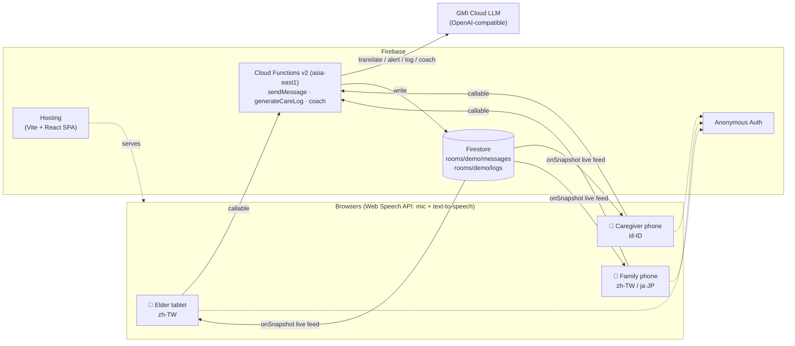

# AmaTomo — One care team, every language

AmaTomo is a shared "care room" for an elder in Taiwan (Mandarin), a migrant caregiver (Bahasa Indonesia), and the elder's family (Traditional Chinese or Japanese). Everyone speaks or types in their own language: AI translates every message, reads incoming messages aloud, flags health red flags to the family, writes a daily care log, and coaches the caregiver.

**The name:** 阿嬤 *a-má* (Taiwanese "grandma") + 友 *tomo* (Japanese "friend").

## Architecture



- **Frontend:** `web/` — Vite + React + TypeScript, Firebase Web SDK. No UI library.
- **Backend:** `functions/` — Cloud Functions v2 callables in `asia-east1`. All LLM code is in `functions/src/llm.ts`.
- **Mock mode:** with no `GMI_API_KEY` (or a placeholder like `placeholder-…`), functions return built-in translations for the 4 demo lines, keyword-based alerts, a rule-based care log, and fixed coach advice. A **MOCK MODE** badge appears in the UI. If a real LLM call fails, functions fall back to mock mode so the demo never breaks.

## Run locally

Requires Node 22, Java (for the Firestore emulator), and `firebase-tools`.

```bash
npm install        # installs root, functions/ and web/
npm run dev        # functions build watch + emulators (Auth, Firestore, Functions) + Vite
```

Open <http://localhost:5173/demo> for the side-by-side recording view, or a single role:

- `/room/demo?role=elder` — tablet, zh-TW
- `/room/demo?role=caregiver` — phone, id-ID, with the AI coach
- `/room/demo?role=family` — phone, zh-TW / ja-JP, alerts and Today's Log

On `localhost` the app always talks to the emulators (project `demo-amatomo`, no real cloud needed). Emulator UI: <http://localhost:4000>.

**Tests:** `npm run test:ci` builds functions, starts the emulators, runs `scripts/smoke-test.mjs`, and stops them. (`npm test` runs the smoke test against emulators you already started with `npm run emulators`.)

## Switch to the real project (config only)

The real project is `amatomodemo` (the default in `.firebaserc`).

1. Create the Firebase project, choosing **asia-east1** for Firestore. Turn on Firestore, **Anonymous Auth** (Authentication → Sign-in method → Anonymous), and the **Blaze** plan (needed for Cloud Functions).
2. Run `firebase use --add` and select the project (already done for `amatomodemo`).
3. Web config: on Firebase Hosting the app loads its config automatically from `/__/firebase/init.json`. To run the web app against the real project from somewhere else, register a web app and copy its config into `web/.env.local` as `VITE_FIREBASE_*` (see `web/.env.example`).
4. Put `GMI_API_KEY`, `GMI_BASE_URL`, `GMI_MODEL` in `functions/.env` (see `functions/.env.example`).
5. Run `npm run deploy` and open the Hosting URL (<https://amatomodemo.web.app>).

```bash
npm run deploy                                            # everything
npx firebase deploy --only functions --project amatomodemo   # after changing functions/.env
```

The GitHub workflows in `.github/workflows` deploy **Hosting only** on merges to `main` and PR previews. Functions and Firestore rules are deployed with `npm run deploy`.

## Privacy

- No audio is stored. Speech is turned into text in the browser and only the text is sent.
- Data stays in the one care room (`rooms/demo`); Firestore rules deny everything else and require sign-in.
- Everyone in the room must consent before it is used with a real family. Reset demo deletes all messages and logs.

## Safety

- The coach never diagnoses and never suggests medication changes.
- Red flags (dizziness, falls, chest pain, breathing trouble, confusion, not eating, injury, severe pain) are flagged to the family, and the coach always tells the caregiver to contact the family or a doctor; escalations appear as red alerts on the family phone.

## Roadmap

- Taiwanese Hokkien speech recognition and voices.
- A dedicated, always-on elder device.
- Japan's care facilities: Japanese-speaking staff working with foreign caregivers.
