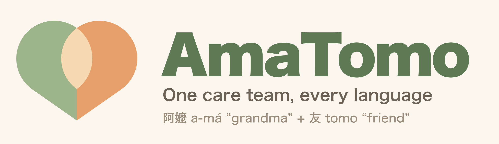
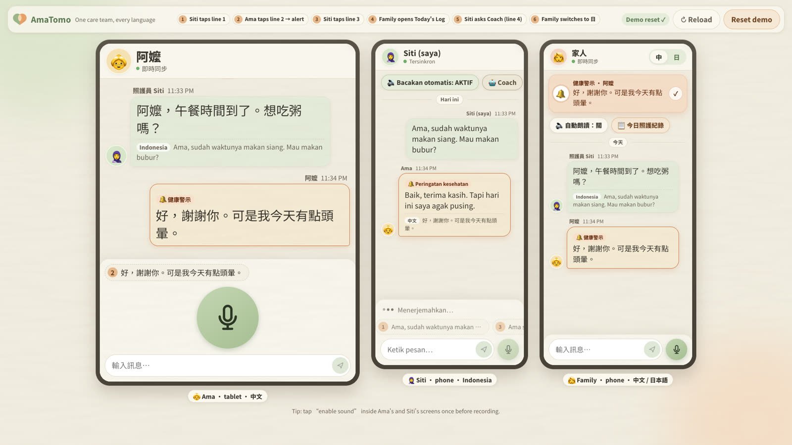
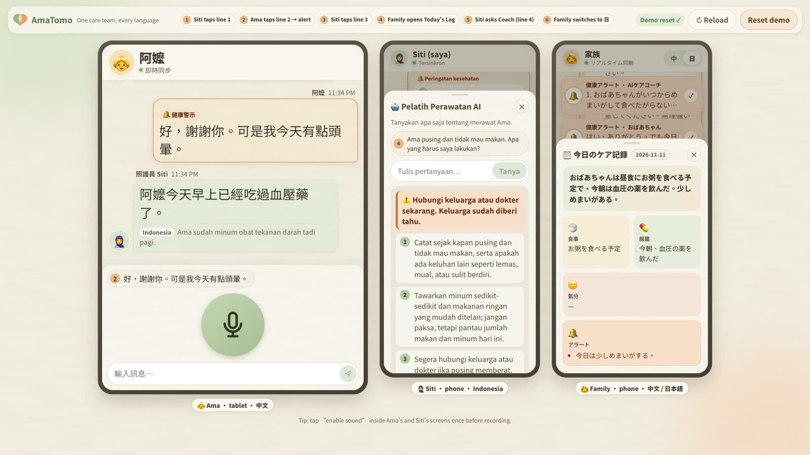
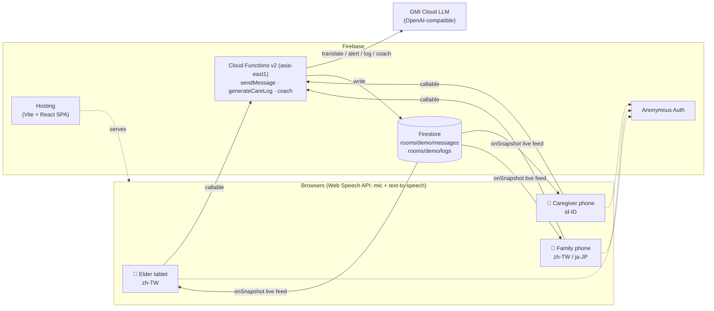

<p align="center">
  
</p>

<p align="center">
  <a href="https://amatomodemo.web.app"><b>🌐 Live demo: amatomodemo.web.app</b></a>
  &nbsp;·&nbsp;
  <a href="https://amatomodemo.web.app/demo">🎬 Three-device demo view</a>
</p>

<p align="center">
  
  
  
  
</p>

---

## What is AmaTomo?

In Taiwan, an elder who speaks Mandarin is often cared for at home by a migrant caregiver who speaks Bahasa Indonesia, while the family works in the city or abroad and may read Chinese or Japanese. Three people, three languages, one person to look after.

**AmaTomo is a shared care room for all three.** Everyone speaks or types in their own language. AI translates every message, reads it aloud in the listener's language, flags health red flags to the family, writes a daily care log, and coaches the caregiver.

**The name:** 阿嬤 *a-má* (Taiwanese for "grandma") + 友 *tomo* (Japanese for "friend").

## Try it

Open **<https://amatomodemo.web.app/demo>** in Chrome on a laptop to see all three devices side by side, or open each role on its own device:

| Role | Device | Language | Link |
|---|---|---|---|
| 👵 Ama (elder) | Tablet | 中文 (zh-TW) | [/room/demo?role=elder](https://amatomodemo.web.app/room/demo?role=elder) |
| 🧕 Siti (caregiver) | Phone | Bahasa Indonesia (id-ID) | [/room/demo?role=caregiver](https://amatomodemo.web.app/room/demo?role=caregiver) |
| 👩 Family | Phone | 中文 / 日本語 (zh-TW / ja-JP) | [/room/demo?role=family](https://amatomodemo.web.app/room/demo?role=family) |

Tips:
- Tap **🔊 enable sound** once on Ama's and Siti's screens so incoming messages are read aloud (browsers block audio until you tap).
- Tap 🎤 to speak, or use the numbered quick lines to follow the demo script.
- **Reset demo** on `/demo` clears the room.
- On a phone, use **Add to Home Screen** to install it like an app.

## Screenshots

**A health red flag reaches everyone.** Ama says she feels dizzy in Mandarin. Siti reads it in Indonesian, and the family phone shows an alert.



**The coach and the care log.** Siti asks the AI coach what to do and gets three calm steps in Indonesian. The family switches to Japanese and reads today's care log.



## Features

- 🌏 **Live translation** of every message into zh-TW, id-ID and ja-JP. The app detects what language a message is really written in, so the family can type Chinese or Japanese whatever the toggle says.
- 🎤 **Voice in, voice out.** Speech recognition in each person's language, and incoming messages read aloud in the listener's language. No audio leaves the browser.
- 🔔 **Health alerts.** Red flags such as dizziness, falls, chest pain, breathing trouble, confusion, not eating, injury or severe pain are pinned as alerts on the family phone.
- 📋 **Today's care log.** One tap gives the family a summary of meals, medication, mood and alerts, in Chinese or Japanese.
- 🤖 **Caregiver coach.** Siti can ask what to do and get 3 calm, practical steps in Indonesian. The coach never diagnoses, and urgent situations are escalated to the family.
- 👵 **Built for each person.** A large-text tablet layout with one huge mic for Ama, phone layouts for Siti and the family, and a warm washi-paper design.

## The demo story

| # | Who | Says (original) | What happens |
|---|---|---|---|
| 1 | Siti | *Ama, sudah waktunya makan siang. Mau makan bubur?* | Ama's tablet shows and speaks 「阿嬤，午餐時間到了。想吃粥嗎？」 |
| 2 | Ama | 好，謝謝你。可是我今天有點頭暈。 | Siti hears it in Indonesian, and a **red-flag alert** appears on the family phone |
| 3 | Siti | *Ama sudah minum obat tekanan darah tadi pagi.* | Everyone sees that the blood-pressure medicine was taken |
| 4 | Family | taps **Today's Log** | Meals, medication, mood and alerts, summarized |
| 5 | Siti → Coach | *Ama pusing dan tidak mau makan. Apa yang harus saya lakukan?* | 3 steps in Indonesian, escalated to the family |
| 6 | Family | switches to **日** | The feed and the care log switch to Japanese |

## How it works



1. The browser turns speech into text with the Web Speech API (or the person types).
2. `sendMessage` detects the real language, asks the LLM for all three translations plus a red-flag check in one call, and writes the message to Firestore.
3. Every device listens with `onSnapshot`, shows the message in its own language, and reads it aloud.
4. `generateCareLog` summarizes today's messages (Asia/Taipei date) for the family. `coach` answers the caregiver and posts its advice to the feed, marked as an alert when it escalates.

| Layer | Tech |
|---|---|
| Frontend | Vite, React 18, TypeScript, Firebase Web SDK (no UI library) |
| Backend | Firebase Cloud Functions v2 callables, Node 22, region `asia-east1` |
| Data | Cloud Firestore with live `onSnapshot` listeners |
| Auth | Firebase Anonymous Auth (signs in automatically, no login screen) |
| Speech | Browser Web Speech API (`SpeechRecognition`, `speechSynthesis`) |
| LLM | GMI Cloud, OpenAI-compatible Chat Completions (default `deepseek-ai/DeepSeek-V4.1-Flash`) |

### Project structure

```
.
├─ web/                   # Vite + React app
│  ├─ src/pages/          # Landing, Room (elder / caregiver / family), Demo
│  ├─ src/components/     # Feed, Composer, AlertBanners, LogCard, CoachPanel, Sheet
│  └─ public/             # favicon, app icons, manifest
├─ functions/             # Cloud Functions
│  └─ src/
│     ├─ index.ts         # sendMessage, generateCareLog, coach
│     ├─ llm.ts           # all GMI Cloud calls (JSON-only, validated, 1 retry)
│     ├─ mockData.ts      # mock mode: demo-line translations, alert keywords, log rules
│     └─ shared.ts        # validation, rate limit, language detection, Taipei dates
├─ scripts/smoke-test.mjs # end-to-end test against the emulators
├─ brand/                 # logo files
├─ firebase.json · firestore.rules · .firebaserc
└─ PROGRESS.md            # build log, decisions, manual checks
```

## Run locally

Requires **Node 22**, **Java** (for the Firestore emulator) and **firebase-tools**.

```bash
npm install     # installs root, functions/ and web/
npm run dev     # functions build watch + emulators (Auth, Firestore, Functions) + Vite
```

Then open <http://localhost:5173/demo>. On `localhost` the app always uses the emulators (project `demo-amatomo`), so no real cloud project is needed. The Emulator UI is at <http://localhost:4000>.

### Tests

```bash
npm run test:ci     # build, start emulators, run the smoke test, stop
npm run test:real   # same, but fails if any function falls back to mock mode
```

The smoke test signs in anonymously, sends the demo lines, and checks the translations, the alert, the care log in zh-TW and ja-JP, the coach escalation, the 500-character limit, and language detection.

## Configuration

**`functions/.env`** (copy from `functions/.env.example`; never committed):

| Variable | Default | Notes |
|---|---|---|
| `GMI_API_KEY` | *(empty)* | Empty or `placeholder…` turns on **mock mode** |
| `GMI_BASE_URL` | `https://api.gmi-serving.com/v1` | Any OpenAI-compatible endpoint |
| `GMI_MODEL` | `deepseek-ai/DeepSeek-V4.1-Flash` | Fast, clean JSON (~3 s per translation) |
| `GMI_REASONING_EFFORT` | `none` | Turns off hidden "thinking" so replies aren't empty. Set it empty for models that reject the parameter |

**`web/.env.local`** (optional): `VITE_FIREBASE_API_KEY`, `VITE_FIREBASE_AUTH_DOMAIN`, `VITE_FIREBASE_PROJECT_ID`, `VITE_FIREBASE_APP_ID`. On Firebase Hosting the app reads its config from `/__/firebase/init.json` automatically, so this is only needed elsewhere.

### Mock mode

Without a GMI key, everything still works. You get real translations for the 4 demo lines, keyword alerts (頭暈, pusing, dizzy, 跌倒, jatuh, 胸痛, sakit dada…), a rule-based care log, and fixed 3-step coach advice, and a **MOCK MODE** badge appears. If a real LLM call fails, the functions also fall back to mock mode, so a live demo never breaks.

## Deploy

One-time setup in the Firebase console:

1. Create the project on the **Blaze** plan and create Firestore in **asia-east1**.
2. Turn on **Authentication → Sign-in method → Anonymous**.
3. Select the project with `firebase use --add` (this repo uses `amatomodemo`).
4. Put the GMI settings in `functions/.env`.

Then:

```bash
npm run deploy   # builds and deploys Hosting, Functions and Firestore rules
```

HTML is served with `no-cache` and hashed assets are cached for a year, so a new deploy shows up on the next reload. The GitHub workflows in `.github/workflows` deploy Hosting only (on merges to `main` and as PR previews).

## Privacy

- **No audio is stored.** Speech becomes text in the browser, and only the text is sent.
- **Data stays in the room.** Firestore rules allow only signed-in users to access `rooms/demo` and deny everything else.
- **Consent first.** Everyone in a care room must agree before it is used with a real family. Reset demo deletes all messages and logs.

## Safety

- The coach **never diagnoses** and **never suggests medication changes**.
- Red flags always go to the family. Urgent coach answers tell the caregiver to contact the family or a doctor right away, and appear as alerts on the family phone.
- Each function requires sign-in, limits input to 500 characters, caps output tokens, and rate-limits each room.

## Roadmap

- 🗣️ Taiwanese Hokkien (台語) speech recognition and voices
- 📱 A dedicated, always-on elder device
- 🔔 Push notifications for alerts when the family's app is closed
- 🇯🇵 Japan's care facilities: Japanese-speaking staff working with foreign caregivers

## Brand

The logo is two speech bubbles, matcha green and persimmon orange, overlapping into one heart: two languages, one shared care. The files are in [`brand/`](brand): the app icon (`amatomo-icon.svg`, 1024px PNG), the transparent mark (`amatomo-mark.svg`), and the horizontal lockup (`amatomo-lockup.svg` / `.png`).
